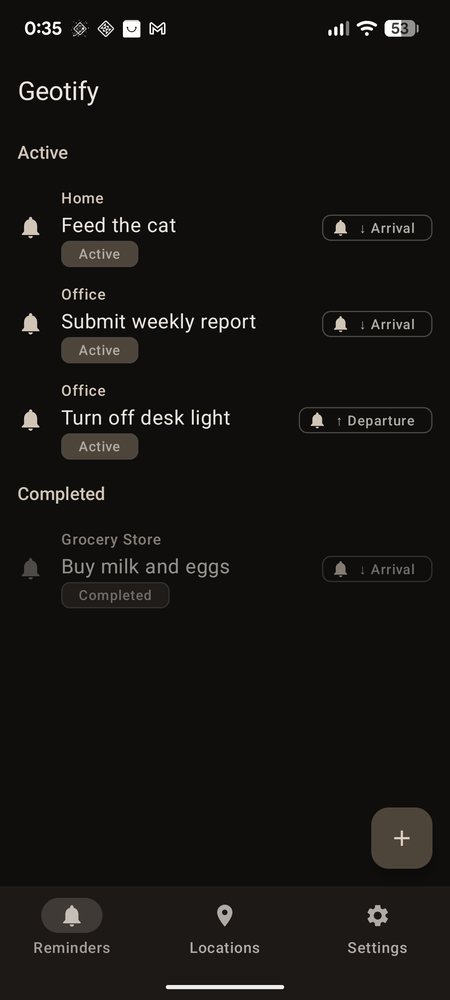
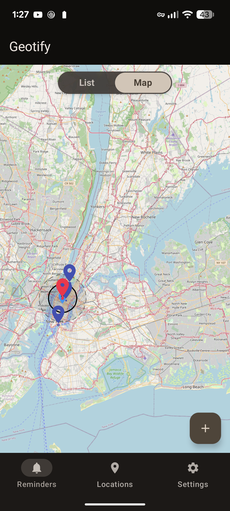
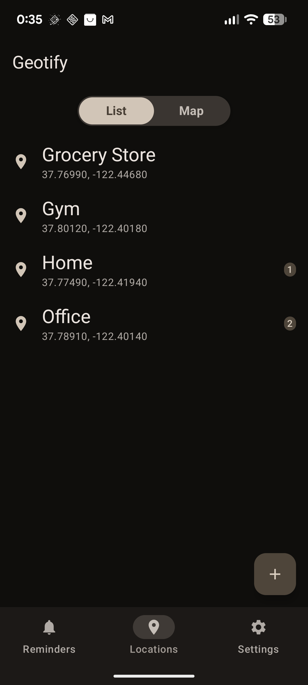
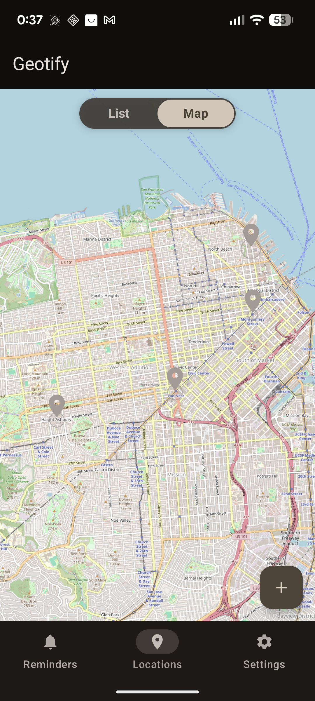
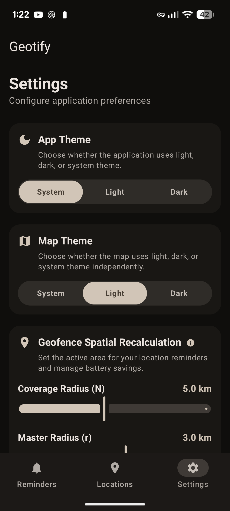

---
hide:
  - toc
---

  

    <i class="fa-solid fa-map-location-dot" aria-hidden="true"></i>
    Location-Aware Android Reminders
  

  <h1>Geotify</h1>
  
A modern, privacy-focused Android application for intelligent geofenced reminders, pairing a Jetpack Compose Material 3 UI and offline-capable OpenStreetMap rendering with system-level Jetpack AppFunctions for AI assistants.

  

    
    
    
    
    
  

  

    
    
    
    
    
    
    
    
    
    
  

!!! tip "Join the Open Beta on Google Play! 🚀"
    Geotify is available in Open Beta. You can download and test the app directly from the [Google Play Store](https://play.google.com/store/apps/details?id=dev.arrase.geotify).

  <h2>Key Features</h2>
  Geofencing engine &amp; AI assistant integration

  

    <i class="fa-solid fa-map-location-dot feature-icon" aria-hidden="true"></i>
    <h3>Interactive Location Management</h3>
    
Save exact GPS coordinates or select custom locations interactively with an embedded Map Picker. Customize alias names, geofence radii (50m to 5km), and notification responsiveness (0 to 10 minutes).

  

  

    <i class="fa-solid fa-bell feature-icon" aria-hidden="true"></i>
    <h3>Dynamic Geofenced Reminders</h3>
    
Configure arrival (enter) or departure (exit) triggers for saved locations with custom reminder notes and reliable background notifications.

  

  

    <i class="fa-solid fa-sliders feature-icon" aria-hidden="true"></i>
    <h3>Sliding Window Engine</h3>
    
Overcomes the system-level 100 geofence limit on Android by dynamically active-monitoring the 99 nearest points of interest (POIs) alongside 1 Master Geofence.

  

  

    <i class="fa-solid fa-robot feature-icon" aria-hidden="true"></i>
    <h3>Jetpack AppFunctions (AI Ready)</h3>
    
Exposes discoverable system APIs, enabling on-device Large Language Models (LLMs) and voice assistants to query, save locations, and create reminders autonomously.

  

  

    <i class="fa-solid fa-map feature-icon" aria-hidden="true"></i>
    <h3>OpenStreetMap (osmdroid)</h3>
    
Fully offline-capable, embedded map rendering with theme-aware tile filtering for automatic light and dark map tiles.

  

  

    <i class="fa-solid fa-palette feature-icon" aria-hidden="true"></i>
    <h3>Material Design 3 &amp; i18n</h3>
    
Clean, fluid Compose layout supporting dynamic colors, micro-animations, permission banners, and native localization in English, Spanish, German, French, Italian, and Portuguese.

  

  <h2>Screenshot Gallery</h2>
  Material Design 3 &amp; interactive OpenStreetMap UI

| Reminders List | Reminders Map |
| :---: | :---: |
|  |  |

| Locations List | Map Picker | Settings |
| :---: | :---: | :---: |
|  |  |  |

  <h2>Documentation</h2>
  Architecture, geofencing math &amp; Android setup

  <a href="architecture/" class="feature-card">
    

      <i class="fa-solid fa-sitemap feature-icon" aria-hidden="true"></i>
      Read →
    

    <h3>Architecture</h3>
    
Technical breakdown of MVVM + Clean Architecture, component interaction flow, tech stack, and osmdroid Compose integration.

  </a>

  <a href="geofencing/" class="feature-card">
    

      <i class="fa-solid fa-location-crosshairs feature-icon" aria-hidden="true"></i>
      Read →
    

    <h3>Geofencing Engine</h3>
    
Deep dive into the Sliding Window algorithm, spatial bounding box math formulas, Master Geofence vs POIs, WorkManager scheduling, and transition receivers.

  </a>

  <a href="appfunctions/" class="feature-card">
    

      <i class="fa-solid fa-robot feature-icon" aria-hidden="true"></i>
      Read →
    

    <h3>AppFunctions (AI Integration)</h3>
    
Overview of Jetpack AppFunctions schemas, callable APIs, and assistant integration.

  </a>

  <a href="database/" class="feature-card">
    

      <i class="fa-solid fa-database feature-icon" aria-hidden="true"></i>
      Read →
    

    <h3>Database Schema</h3>
    
Room DB entities (LocationEntity, ReminderEntity), indexes, and DataStore preferences.

  </a>

  <a href="permissions/" class="feature-card">
    

      <i class="fa-solid fa-shield-halved feature-icon" aria-hidden="true"></i>
      Read →
    

    <h3>System Permissions</h3>
    
Permission handling for background location, notification posts, activity recognition, and boot triggers.

  </a>

  <a href="screens/" class="feature-card">
    

      <i class="fa-solid fa-mobile-screen-button feature-icon" aria-hidden="true"></i>
      Read →
    

    <h3>UI &amp; Screen Guide</h3>
    
Overview of screens, ViewModels, UI state management, and custom Compose map overlays.

  </a>

  <a href="building/" class="feature-card">
    

      <i class="fa-solid fa-hammer feature-icon" aria-hidden="true"></i>
      Read →
    

    <h3>Building &amp; Development</h3>
    
Prerequisites, build scripts, Gradle dependencies, and developer environment setup.

  </a>

